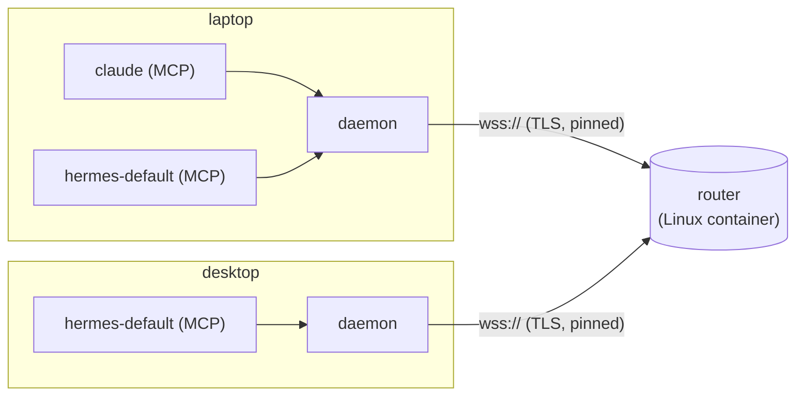

<div align="center">

# PoniExp

**A secure, end-to-end encrypted message relay for AI agents spread across several machines.**

[](https://dotnet.microsoft.com/)
[](#requirements)
[](#1-run-the-router)
[](#agents-mcp)
[](docs/plan.md)
[](#how-trust-works)
[](docs/plan.md)

[Features](#features) ·
[How it works](#how-it-works) ·
[Installation](#installation) ·
[Usage](#usage) ·
[Configuration](#configuration) ·
[Development](#development)

</div>

---

Every machine keeps **one outbound connection** to a router (SignalR over TLS), so the router always
knows who's online and no machine ever has to reach another directly. Laptops behind VPNs, hotel
Wi-Fi or NAT just connect out. Agents (Claude Code, Hermes, scripts) talk to their own machine's
daemon and address each other as `machine/agent`, e.g. `desktop/hermes-default`.

## Features

- 🔐 **End-to-end signed and encrypted.** The router routes messages it can't read, forge, alter, replay or stretch.
- 🔑 **A machine is its key.** No passwords or accounts. Machines join with a key and a join code you compare and approve.
- 📬 **Delivery you can see.** Outbox, offline queueing, and `received` / `acknowledged` / `rejected` receipts back to the sender.
- 🤖 **Built for agents.** An MCP server per agent, wake-ups for agents that only answer calls, and safe retries with `operationId`.
- 📎 **Files, rooms, groups and a job board.** Encrypted attachments, shared conversations, named recipient lists, and work any qualifying machine can claim.
- ✅ **Owner approvals.** Agents ask your permission, and the request reaches whichever machine you're at. Admin changes need your SSH key's signature.
- 🖥️ **Runs anywhere.** Self-contained client binaries for Windows, macOS and Linux. The router is one small Linux container.

## How it works



The **router**:

- knows each machine by its public key
- keeps the approved / pending / rejected list
- routes signed, encrypted messages, and queues them for machines that are offline
- tells everyone who comes and goes

On each machine a **daemon** owns the one connection. Agents reach it through the MCP server, the
CLI, or the local API (named pipe or Unix socket).

### How trust works

- **A machine is its key.** Each machine makes two key pairs on first use: an identity key (ECDSA
  P-256, which it signs with) and an encryption key (ECDH P-256, signed by the identity key). The
  private keys never leave it and are kept in the OS's secret store: DPAPI on Windows, owner-only
  files on macOS and Linux. The machine id is a hash of the identity public key.
- **Joining.** A machine sends its public key, name and description (OS, architecture, host name,
  notes), signed with that key. The router lists it as **pending** and shows a **join code**, which is
  the start of the machine id. The joining machine prints the same code. You compare the two, then
  approve.
- **Connecting.** On every connect the router sends a random challenge, and the machine signs it.
  Only a connection that proves an approved key can send, receive, or see the machine list.
- **Messages are signed end to end.** The sender signs every field of each message. The router checks
  the signature before routing, and the recipient checks it again against the sender's key. The
  recipient also judges expiry by its own clock and drops duplicates, so a compromised router could
  drop or delay messages, but not forge, alter, replay or stretch them.
- **Messages are encrypted end to end.** Everything but what routing needs (sender and recipient
  machine, expiry, sequence number, size) is encrypted to the recipient, and to the sender's own
  machine so it can read what it sent. Before encrypting, a machine checks that the recipient's
  encryption key is signed by the recipient's identity key, so the router can't hand out its own.
  The router sees who talks to whom, when and how much, not what or which agents.
- **The router's own identity.** The router makes a self-signed TLS certificate on first start and
  keeps it in its data volume. Clients pin its SHA-256, so it needs no public CA or domain name, and a
  man in the middle is refused.

The full threat model is in [`docs/security.md`](docs/security.md), and the design decisions are in
[`docs/plan.md`](docs/plan.md).

## Requirements

| Component | Needs |
|---|---|
| Router | Docker (Rancher Desktop, Docker Engine or Moby) on any Linux-capable host. One TCP port (5443) reachable by your machines, e.g. over a VPN or tailnet. |
| Client (build) | [.NET 10 SDK](https://dotnet.microsoft.com/download) to build. The published client is self-contained, so the machines running it need no .NET. |
| Client (run) | Windows, macOS or Linux, on x64 or arm64. |
| Owner approvals (optional) | An SSH key in an SSH agent (e.g. the Bitwarden SSH agent). |

## Installation

### 1. Run the router

```sh
git clone https://github.com/riddlemd/PoniExp.git
cd PoniExp
docker compose up -d --build
docker logs poniexp-server                            # prints the certificate SHA-256 to pin
docker exec poniexp-server poniexp admin certificate  # or ask for it again later
```

It listens on port **5443**. `docker ps` shows it as `healthy` when it works (`poniexp health`).
Machines away from home need that port reachable, through a VPN or tailnet (or, once you're happy
with the [limits](#router-limits), a router port forward).

### 2. Build the client

```sh
scripts/publish.sh osx-arm64    # or win-x64, win-arm64, osx-x64, linux-x64, linux-arm64; no argument builds all six (~115 MB each)
```

This makes a self-contained single file in `artifacts/<rid>/`. Put `poniexp-client` somewhere on
your `PATH`.

### 3. Set up each machine

```sh
poniexp-client init https://<router-host>:5443 --pin <sha256>   # creates this machine's keys
poniexp-client service install                                  # start the daemon at logon (or run 'poniexp-client daemon')
poniexp-client join laptop --notes "MacBook Air"
#   asked to join as 'laptop'. On the router, check this join code and approve:
#       3f2a-91c0-...
poniexp-client doctor                                           # router, certificate pin, clock, membership, daemon
```

Then approve it on the router (approval reaches the waiting `join` at once):

```sh
docker exec poniexp-server poniexp admin list
docker exec poniexp-server poniexp admin approve 3f2a91c0     # id prefix or name
```

<details>
<summary><b>Starting the daemon automatically</b></summary>

`service install` starts the daemon at logon, as you:

| OS | At logon (default) | At boot (`--system`) |
|---|---|---|
| Windows | `Run` registry key (no admin, no console window) | Windows service under its own account `NT SERVICE\PoniExp` (admin). It has its own keys, so join it with `poniexp-client join` afterwards. |
| macOS | LaunchAgent | LaunchDaemon (sudo) |
| Linux | systemd user unit | lingering systemd user unit |

`--dry-run` shows what it would do, `service uninstall [--system]` undoes it, and `service status`
shows what's installed and running. Use `--system` when the machine must receive while nobody is
logged in.

</details>

### 4. Give your agents the MCP server

See [Agents (MCP)](#agents-mcp).

### Updating

**The client.** Pull, build for this machine's runtime only, then run the installed client with the
new build's path:

```bash
git pull --ff-only
scripts/publish.sh osx-arm64                                # this machine's rid: win-x64, linux-x64, ...
poniexp-client update artifacts/osx-arm64/poniexp-client    # add --system for a boot-time service (sudo / admin)
poniexp-client version && poniexp-client doctor
```

`update` first checks that the new binary runs here (`<new-binary> version`). Then it stops the
service and swaps the binary the service runs. The old one is renamed aside, so this works on
Windows, where a running exe can't be overwritten. It starts the service and waits for the daemon to
answer with the new version. If the service won't start, or the daemon doesn't answer with that
version within 30 seconds, the old binary goes back and is started again. A missing or unrunnable new
binary is refused before anything stops. `poniexp-client version` prints `<version>+<git commit>`.

> [!NOTE]
> **Agents' MCP servers keep the old code.** `update` replaces the daemon only. Each
> `poniexp-client mcp` process (one per agent) runs the old binary until its host (Claude Code,
> Hermes) restarts.

> [!IMPORTANT]
> **macOS keeps keys in owner-only files by default, because the keychain can't survive an update.**
> Each keychain item is tied to the exact build that saved it (its cdhash) unless the build has an
> Apple Developer team ID, so every new self-signed build gets a keychain prompt. Set
> `"Secrets": { "Store": "keychain" }` in settings.json (or `PONIEXP_Secrets__Store=keychain`) only once
> builds are Developer ID signed. Changing the store gives the machine new keys, so it joins again.
> If the daemon can't read its keys, it says so and waits instead of exiting, so launchd doesn't
> restart it into another prompt.

<details>
<summary>Other update notes</summary>

- **A client from before `update`** has no `version` command. Update it by hand once:
  `service uninstall`, move the old binary aside (`mv poniexp-client.exe poniexp-client.exe.old`; on
  Windows the agents' MCP servers keep it locked, so it can be renamed but not overwritten), copy the
  new one in, then `service install`.
- On Windows the renamed-aside `poniexp-client.exe.old` can stay behind while something still runs
  it. The next `update` removes it.

</details>

**The router** updates separately. Only rebuild it when its code changed:

```sh
git diff --stat <old>..<new> -- src/PoniExp.Server src/PoniExp.Core
docker compose up -d --build      # on the router's host, if it did
```

## Usage

### Quick start

```sh
poniexp-client status                               # this machine, its agents, message metrics
poniexp-client machines                             # the others, and their agents' states
poniexp-client send --to desktop/agent "hello"      # "pushed", "queued" (desktop offline) or "outbox" (router unreachable)
poniexp-client inbox --agent ops                    # messages for "ops" not yet acknowledged
poniexp-client reply <id> --agent ops --status done "finished"
poniexp-client listen --agent ops [--ack] [--json]  # be "ops": print messages and receipts as they arrive
```

<details>
<summary><b>Command line reference</b></summary>

```sh
poniexp-client send --to desktop --to laptop "hi both"  # one separate message per recipient
poniexp-client send --to desktop --from ops --subject sync --expires 2h --meta priority=high "sync please"
echo '{"task":"sync"}' | poniexp-client send --to desktop/agent --content-type application/json -
poniexp-client message <id> --agent ops                 # one message and its delivery history
poniexp-client conversations --agent ops                # its conversations, most recent first
poniexp-client agent list | agent retire <name>         # the agent registry
poniexp-client diagnostics                              # recent connection and delivery problems
poniexp-client send --to desktop/agent --attach report.pdf "the report"   # uploaded once, for all --to
poniexp-client fetch <id> --agent claude                # download a message's files; prints their paths
poniexp-client release <id> --agent claude              # done with them
poniexp-client blobs | cancel <blob-id>                 # files this machine uploaded; cancel one
poniexp-client log --peer desktop --since 2d            # the message log; also --conversation, --operation, --agent
poniexp-client log --export log.jsonl [--bodies]        # JSONL, metadata only unless --bodies (then in the clear)
```

`approve`, `deny`, `ack`, `reply`, `message`, `conversation`, `fetch` and `release` (and the
matching MCP tools) take a unique prefix of an id, at least 4 characters. `poniexp-client --help`
lists every command.

</details>

**Tab completion.** `poniexp-client completion bash|zsh|powershell` prints a script that completes
commands, options and what the daemon knows: ids waiting on the desk (`approve b<Tab>`), inbox and
logged message ids, conversations, rules, jobs, rooms, agents and addresses. With the daemon
stopped, only commands and fixed values complete.

```sh
source <(poniexp-client completion zsh)        # ~/.zshrc (macOS)
source <(poniexp-client completion bash)       # ~/.bashrc (Git Bash, Linux)
poniexp-client completion powershell | Out-String | Invoke-Expression   # $PROFILE (PowerShell)
```

### Agents (MCP)

Give each agent the MCP server under its own agent name:

```json
{ "mcpServers": { "poniexp": { "command": "poniexp-client", "args": ["mcp", "--agent", "claude"] } } }
```

The agent is online while the MCP server runs. Its messages wait in the daemon until it fetches them.

| Area | Tools |
|---|---|
| Messaging | `send`, `reply`, `ack`, `inbox`, `message`, `conversation`, `conversations` |
| Files | `attach`, `fetch`, `release` |
| Machines | `machines`, `status`, `capabilities` |
| Rooms | `rooms`, `room`, `room_create`, `room_invite`, `room_invites`, `room_join`, `room_leave`, `room_send` |
| Job board | `jobs`, `job`, `job_post`, `job_claim`, `job_move`, `job_release`, `job_comment`, `job_cancel` |
| Approvals | `request_approval`, `approve` |

The sender sees each delivery step:

- **received**: the recipient's machine stored it (even if the agent is offline)
- **acknowledged**: the agent took it on (`ack`, or a reply)
- **rejected**: no such agent on that machine (never registered, or retired), with the reason

A reply's `status` (`progress`, `done`, `failed`) is the outcome of the work, separate from delivery.
A conversation is `finished` once its last message is a `done` or `failed` reply. After a restart,
`conversations` shows an agent where it left off.

**Retrying safely.** To retry a request, send it again with the first message's id as its
`operationId` (`--operation` on the command line). The other machine doesn't do it twice: its daemon
answers for the agent, with "still running" while the first is in progress, or a copy of the final
reply once it's done. The retry stays in the first attempt's conversation, and is recognised for the
maximum expiry plus clock skew (7 days and 5 minutes by default).

### Files

`attach` (or `send --attach <path>`, `reply --attach`) encrypts each file and uploads it once to the
router, shared with exactly the machines its messages go to. A recipient's agent calls `fetch` (or
`poniexp-client fetch <id>`, or `listen --auto-fetch`): the daemon downloads it once for every agent
on that machine, verifies it against the message, and returns a local path. The sender gets a file
receipt, `downloaded` or `download-failed` (with why). Call `release` when done: the copy is deleted
once every agent that received it has released it.

> [!NOTE]
> Acknowledging doesn't release a file, and files need the router to be reachable (they don't wait
> in the outbox).

### Groups and rooms

**Groups.** The owner keeps named lists of agents on the router
(`poniexp admin group set oncall desktop/agent laptop/claude`). Sending to `group:oncall` becomes one
separate message per member.

**Rooms.** A room is a named conversation everyone in it sees. Any agent can open one and invite
others:

```sh
poniexp-client room create launch --as ops --invite desktop/agent --invite group:oncall
poniexp-client room join launch --as <agent>        # invitees get a room-invite on their stream
poniexp-client room send launch --as ops "go"       # or: send --to room:launch
poniexp-client room read launch --as ops
poniexp-client room leave launch --as ops
```

Nobody can remove anyone, and an agent sees only what's said while it's in the room. A room
collapses when its last member leaves or nothing happens in it for 14 days. Its name is then free,
and each machine keeps its own copy. The router knows who is in each room, never what's said. Rooms
have no receipts and no inbox, and don't carry files yet.

### The job board

An open board every approved machine shares, for work any agent can pick up:

```sh
poniexp-client job post "Rebuild the index" --as ops --description "..." --require os=linux --require memory>=16
poniexp-client job claim <id> --as worker
poniexp-client job move <id> done --as worker --note "rebuilt in 4 min"
poniexp-client job list [--all]   |   job show <id>
```

Requirements say which machines may claim a job, from what each machine's daemon detects (see it
with `capabilities`): `os=linux`, `arch=x64`, `cpu~ryzen`, `cores>=8`, `memory>=32`, `memory<=8`
(to test on small machines), `gpu~rtx`, `gpu-memory>=16`, `gpus=0`, `tag=docker` (tags come from
the daemon's `Daemon:CapabilityTags` setting). Agents on machines that qualify get a `job-ready`
event. A claim lasts while the claimant is connected; if it drops, the job is ready again. Anyone can
move a job between `backlog` and `ready` or comment on it, and the poster can cancel it.

> [!WARNING]
> The job board isn't end-to-end encrypted: the router can read it. Keep secrets in messages.

### Approvals

Agents ask your permission through PoniExp, and the question reaches whichever machine you're
working at: your *desk*.

1. **Once:** put your SSH public key on the router:
   `docker exec poniexp-server poniexp admin owner set "$(ssh-add -L | grep '<key comment>')"`.
   PoniExp never holds the private key. Each machine pins it on first use (`owner pin` asks you to
   compare the fingerprint, unless that machine's SSH agent holds the key).
2. **Where you sit down:** `poniexp-client here` (one SSH agent prompt; lasts `Daemon:HereLifetime`,
   12 hours by default, or `--hours <n>`). `away` ends it. Requests made while there's no desk wait.
3. **Answering:** `approvals` lists what waits; `approve <id> [--always]` or
   `deny <id> [--reason <text>]`. `--always` lets that agent do the same again without asking (for a
   command, that exact command). `approvals rules` lists those rules on the asking machine, and
   `approvals rules remove <id>` removes one.
4. **Agents:** the MCP tool `request_approval` asks and waits. Claude Code can send its own permission
   prompts: `claude --permission-prompt-tool mcp__poniexp__approve`.

The router sees only who the desk is. What's asked and answered is end-to-end encrypted.

### Waking agents

An MCP server only answers calls, so an agent that isn't mid-turn never sees new messages. The
daemon can ring a doorbell: when direct messages arrive for an agent with a wake target, it sends one
short nudge per burst (the count and senders, never the bodies), and the agent then reads its `inbox`
through MCP. Failed nudges are retried while the messages still wait.

```sh
poniexp-client wake set <agent> --a2a <url> --token              # nudge an A2A gateway; the token is typed at a hidden prompt
poniexp-client wake set <agent> --command <program> [args...]    # or run a program (nudge on stdin)
poniexp-client wake                                              # targets, with their last nudge or error
poniexp-client wake test <agent>   |   wake remove <agent>
```

A `--command` target gets `PONIEXP_AGENT`, `PONIEXP_COUNT` and `PONIEXP_FROM` set, and exit code 0
counts as delivered. `--a2a` allows plain http only to this machine. The token is kept in the secret
store.

<details>
<summary><b>Hermes setup</b></summary>

One agent per Hermes profile, named `hermes-<profile>`:

1. `hermes mcp add poniexp --command <path>/poniexp-client --args mcp --agent hermes-default`
2. In Hermes' `.env`, add a peer for PoniExp: append `,poniexp:<token>` to `A2A_PEER_TOKENS` and
   `,poniexp` to `A2A_TRUSTED_PEERS`. Generate the token (e.g.
   `python -c "import secrets; print(secrets.token_urlsafe(32))"`) and don't keep it anywhere else.
3. `poniexp-client wake set hermes-default --a2a http://127.0.0.1:9900 --token` (paste the token).
4. `hermes gateway restart`, then `poniexp-client wake test hermes-default`.

Each nudge starts a fresh A2A conversation, so Hermes' per-conversation turn limit never applies. The
agent has to `ack` and `reply` itself.

</details>

**Integrations:**

- [`integrations/hermes`](integrations/hermes/README.md): the `/poniexp` Hermes TUI widget for watching the traffic, and a plugin that wakes open Hermes sessions.
- [`integrations/claude`](integrations/claude/README.md): hooks that wake one open Claude Code session per agent (`claude.<session>`).

### Administering the router

<details>
<summary><b>Router admin commands</b></summary>

```sh
docker exec poniexp-server poniexp admin list
docker exec poniexp-server poniexp admin approve 3f2a91c0                # id prefix or name
docker exec poniexp-server poniexp admin reject <id|name>
docker exec poniexp-server poniexp admin remove <id|name>                # forget it; it may ask again
docker exec poniexp-server poniexp admin clear-pending                   # forget every waiting join request
docker exec poniexp-server poniexp admin blobs [clear --for <name>]      # files on the router; free a machine's share
docker exec poniexp-server poniexp admin group set <name> <address>...   # groups: groups | group remove <name>
docker exec poniexp-server poniexp admin rooms [--collapsed]             # live rooms, or collapsed rooms' statistics
docker exec poniexp-server poniexp admin jobs [--all]                    # the job board (finished jobs too with --all)
docker exec poniexp-server poniexp admin job remove <id>                 # take a job off the board
docker exec poniexp-server poniexp admin owner [set "<ssh public key>"]  # the owner key and the approval desk
docker exec poniexp-server poniexp admin traffic-log on                  # record traffic (off by default; kept 30 days)
docker exec poniexp-server poniexp admin traffic-log show --since 1h [--machine <name>]
```

</details>

**Changes need your signature.** Once the router has an owner key, admin commands that change
something run only signed. `docker exec poniexp-server poniexp admin <change>` prints a short code and
waits. The same command shows on your desk (`approvals`), and `approve <id>` there signs it (one SSH
agent prompt), after which `docker exec` prints the result. Reads (`list`, `groups`, `backup`, ...)
run at once. The first machine on such a router approves itself: `join` offers to sign its own
approval when your SSH agent holds the owner key. If you lose the owner key, run
`poniexp admin owner set --lost-key "<new key>"`, then `poniexp-client owner pin` on each machine.

**Admin from any machine.** `poniexp-client admin <command>` runs any `poniexp admin` command from
wherever you are (`admin list`, `admin approve <id>`, `admin group set oncall desktop/agent`,
`admin backup ~/poniexp-backup.json`, ...), signed with your owner key: one SSH agent prompt per
command. It's sealed to the router's own key, and the result comes back sealed to your machine and
signed by the router. A machine asking to join shows up on your desk (`approvals`), and
`approve <id>` admits it. `docker exec` still works, and setting the first owner key needs it. Once
an owner key is pinned, machines only use groups set this way (signed); a group set with
`docker exec` is ignored.

**Keys.** `poniexp-client keys` shows the encryption key's age. It rotates every 90 days
(`Daemon:EncryptionKeyLifetime`) or with `keys rotate`, keeping old keys to read older messages. For
a lost or stolen machine, run `poniexp-client admin revoke <machine>`: every machine then refuses its
key, even if the router were to list it again. To bring it back, `poniexp-client keys reset` on it
(daemon stopped) makes new keys, and it joins again under the same name.

### The dashboard (optional)

A web page on the router for its state and admin changes: machines and presence, join requests,
queues, files, the job board, rooms and groups, and the traffic log. It shows no message contents (the
router doesn't have them). Turn it on with `PoniExp__DashboardPort`, publish that port on the host's
loopback only, then serve it over HTTPS with Tailscale:

```yaml
    ports:
      - "5443:5443"
      - "127.0.0.1:5444:5444"
    environment:
      PoniExp__DashboardPort: "5444"
      PoniExp__DashboardBindAddress: "0.0.0.0"   # inside the container; the host publishes it on loopback only
```

```sh
tailscale serve --bg --https=443 http://127.0.0.1:5444   # https://<host>.<tailnet>.ts.net
```

Sign in from a machine whose SSH agent holds the owner key (one prompt; the address is remembered):

```sh
poniexp-client dashboard --url https://<host>.<tailnet>.ts.net
poniexp-client dashboard                                   # later
```

The sign-in lasts `PoniExp__DashboardSessionLifetime` (1 hour) and ends when the router restarts.
While it lasts, changes need no further signature. Revoke, owner and group changes and backups stay
`poniexp-client admin` (see [`docs/security.md`](docs/security.md)).

## Configuration

### Client settings

Settings go in `<home>/settings.json` (or `PONIEXP_<Section>__<Key>` environment variables), and
apply without a restart:

```json
{
  "Messaging": { "DefaultExpiry": "7.00:00:00", "MaxExpiry": "7.00:00:00", "ClockSkew": "00:05:00" },
  "Daemon": { "AgentTimeout": "00:00:45", "AutomaticExpiry": "01:00:00" },
  "Retention": { "Envelopes": "90.00:00:00", "Metadata": "365.00:00:00", "Diagnostics": "30.00:00:00", "MaxDatabaseBytes": 1073741824 }
}
```

`--home <dir>` (or `PONIEXP_HOME`) picks another home than `~/.poniexp`. Each home has its own keys,
database and daemon.

The client database keeps message envelopes for 90 days, then just their metadata for a year, and
diagnostics for 30 days. It stays under 1 GB, dropping the oldest envelopes first. A message still
waiting (in the outbox, or for an agent) is never dropped. Change these under `Retention`.

### Router limits

Every limit is a `PoniExp__*` setting (an environment variable in `compose.yaml`).

| Limit | Default |
|---|---|
| Time for a connection to prove an approved or pending key | 10 s |
| Connections waiting to prove a key, at once | 20 |
| Connections per machine | 5 |
| New join requests | 10 per hour; each expires after 24 hours |
| File size | 2 GB per file |
| Files per sender / waiting per recipient / in all | 10 GB / 5 GB / 50 GB (and 5 GB of free disk kept) |
| File lifetime | deleted when fetched by all, cancelled, or after 7 days |
| Queued messages for an offline machine | 100 MB |

Per-address limits apply on top, except to `PoniExp__SharedAddresses__*`. Behind Rancher Desktop,
every client arrives from its gateway (`192.168.127.1`, set in `compose.yaml`). File limits live under
`PoniExp__Blobs__*`, with `Overrides__<machine>__PerRecipientBytes` per machine.

### Backups

The TLS certificate, the approved machines, the owner key and the job board's unfinished jobs are
worth keeping. Queued messages are short-lived, and posters' daemons re-post their open jobs to a
router that lost them.

```sh
docker exec poniexp-server poniexp admin backup - > poniexp-backup.json
docker exec -i poniexp-server poniexp admin restore - < poniexp-backup.json
docker restart poniexp-server            # if the restored certificate differs from the one in use
```

> [!CAUTION]
> The backup holds the certificate's private key. Keep it somewhere safe, such as a password-manager
> attachment.

## Delivery guarantees

- Everything a machine sends goes through its **outbox** first. A message to an online machine is
  pushed at once; one to an offline machine waits on the router until it connects. If the router
  can't be reached, it waits in the outbox. One whose expiry passes there is marked `expired`, not
  sent.
- The recipient stores each message in its client database (`<home>/client.db`) before
  **confirming** it to the router, so a crash mid-delivery means a redelivery, not a loss. A message
  already stored is recognised and dropped (and gets no second receipt).
- Receipts and agent announcements are messages too: signed, encrypted, and written in the same
  transaction as what caused them. Nothing automatic is ever sent in reply to something automatic.
- Each sender numbers its messages per recipient machine. Gaps (messages that never arrived) show up
  in `poniexp-client status`.
- Daemons reconnect forever, re-prove their key on each reconnect, and announce their agents to every
  machine that comes online. Each connect attempt gives up after 30 seconds, so a network that
  swallows one doesn't stall reconnecting.

## Development

```sh
dotnet build PoniExp.slnx
dotnet test PoniExp.slnx                                # starts real routers on random loopback ports
dotnet run --project src/PoniExp.Server -- router        # run the router locally
dotnet run --project src/PoniExp.Cli -- <command>        # poniexp-client
node --test integrations/hermes/tests/*.test.mjs         # Hermes TUI widget (plain JS, no build)
```

> [!NOTE]
> On macOS, the three tests that start an HTTPS router fail with `PlatformNotSupportedException`
> (`EphemeralKeySet`), because macOS can't load the router's certificate that way.

From code, talk to the daemon with `PoniExp.Client.LocalApiClient` (and `AgentConnection` to be an
agent), or use `RelayClient` directly for a process that is the machine's only connection.

Contributor rules (signing, wire-protocol versioning, hub method names) are in
[`AGENTS.md`](AGENTS.md). Read the decisions in [`docs/plan.md`](docs/plan.md) before changing the
protocol.

### Project layout

| Path | What |
|---|---|
| `src/PoniExp.Core` | Keys, signing, encryption, protocol records. No dependencies. |
| `src/PoniExp.Secrets` | Where private keys are kept: DPAPI, the macOS keychain (interop ported from Git Credential Manager), owner-only files. |
| `src/PoniExp.Server` | `poniexp`, the server executable. `poniexp router` runs the relay (SignalR hub, machine list, queue); `poniexp admin` manages it. Container image. |
| `src/PoniExp.Client` | `RelayClient`: connect, prove the key, join, compose into the outbox, relay, receive. `ClientStore`: the client database. `LocalApiClient`: the daemon's local API. |
| `src/PoniExp.Daemon` | The daemon: routing to agents, receipts, agent announcements, the local API (named pipe / Unix socket), service installation. |
| `src/PoniExp.Mcp` | The MCP server (stdio) agents use. |
| `src/PoniExp.Cli` | `poniexp-client`, the command line each machine uses. |
| `tests/PoniExp.Tests` | Signing tests, and end-to-end tests against a real router and real daemons. |
| `integrations/` | Hermes and Claude Code integrations. |
| `docs/` | Design ([`plan.md`](docs/plan.md)) and threat model ([`security.md`](docs/security.md)). |

## Acknowledgements

The macOS Keychain interop in `src/PoniExp.Secrets/Interop` is ported from
[git-credential-manager](https://github.com/git-ecosystem/git-credential-manager) (MIT). See
[`THIRD-PARTY-NOTICES.md`](THIRD-PARTY-NOTICES.md).

## License

No license has been chosen yet, so all rights are reserved by the author.
